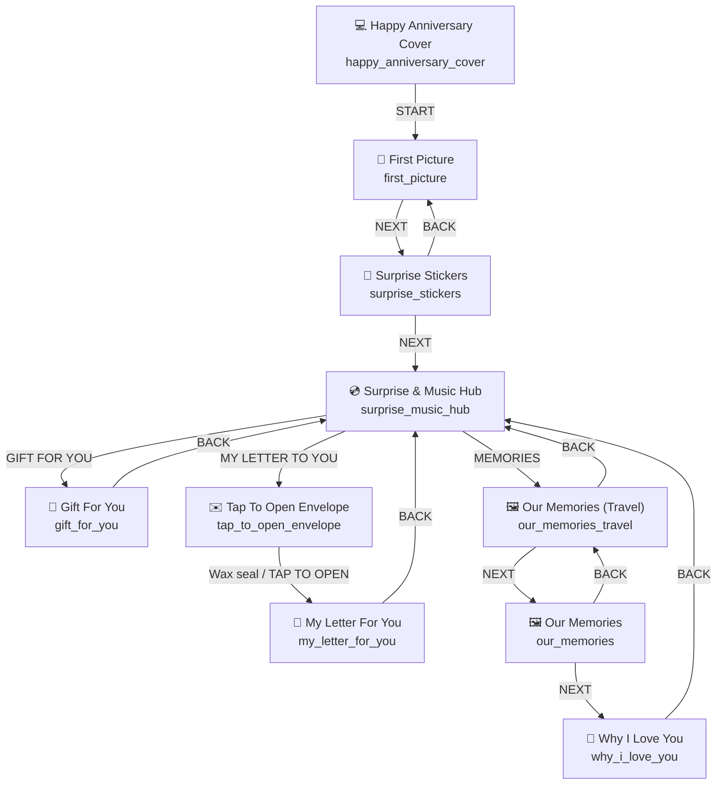

# 💌 Forever Scrapbook

> An interactive, anniversary-themed digital scrapbook website — a keepsake of photos, a love letter, surprise gifts, and a little music, wrapped in a retro-browser and paper-scrapbook design.


---

## 📑 Table of Contents

- [Project Description](#-project-description)
- [Project Overview](#-project-overview)
- [Features](#-features)
- [Website Navigation / User Flow](#-website-navigation--user-flow)
- [Page Descriptions](#-page-descriptions)
- [Tech Stack](#-tech-stack)
- [Project Structure](#-project-structure)
- [Installation & Setup](#-installation--setup)
- [How to Run the Project](#-how-to-run-the-project)
- [How to Use the Website](#-how-to-use-the-website)
- [Screenshots](#-screenshots)
- [Future Improvements](#-future-improvements)
- [Author](#-author)

---

## 📖 Project Description

**Forever Scrapbook** is a digital scrapbook website designed as a romantic anniversary surprise. The visitor opens a cover page, flips through photo "polaroids", taps stickers to reveal sweet notes, clicks a vinyl disc to "play" a song, and then chooses between a gift page, a love letter, and a memories gallery.

The project is a collection of **10 standalone HTML pages** with a shared visual identity (deep navy, sky blue, and warm cream) described in the included design-system document.

## 🔎 Project Overview

| Item | Details |
| --- | --- |
| **Type** | Static multi-page website (prototype) |
| **Pages** | 10 HTML pages (one per screen) |
| **Language** | English (UI copy) |
| **Styling** | Tailwind CSS (via CDN) with a custom theme |
| **Interactivity** | Small vanilla JavaScript snippets inside each page |
| **Build tools** | None — no `package.json`, no bundler |
| **Design reference** | `forever_scrapbook_design_system.md` and a preview image of the screens |

The pages appear to have been generated from a design tool ("Stitch") as a UI prototype, which is why every page lives in its own folder as `code.html`.

## ✨ Features

- 💻 **Retro browser-window cover** with a `START` button
- 📸 **Polaroid photo layouts** with tilted frames that straighten on hover (First Picture page)
- 🎀 **Four tappable stickers** (Memories, Flowers, Wish, Gift) that each reveal a short sweet note
- 💿 **Vinyl disc "player"** that spins and toggles between play / pause states
- 🎁 **Three surprise boxes** that reveal a message when clicked (also keyboard accessible via `Enter` / `Space`)
- ✉️ **Wax-sealed envelope** page and a **pinned love letter** that can be hidden / shown
- 🖼️ **Two memory galleries** (polaroid strip and tall photo cards)
- 📝 **"Why I Love You"** page with a list of ten reasons
- 🎨 **Custom design system**: colour tokens, typography scale, spacing, and motion timings configured in Tailwind
- 📱 **Responsive layout** using Tailwind breakpoints (e.g. mobile/desktop heading sizes, hidden decorations on small screens)

## 🧭 Website Navigation / User Flow

The navigation below is the **intended flow**, taken from the `window.location.href` targets and buttons found in each page's code.



**Button reference (from the code):**

| Page | Button | Goes to |
| --- | --- | --- |
| Cover | `START` | First Picture |
| First Picture | `NEXT` | Surprise Stickers |
| Surprise Stickers | `BACK` / `NEXT` | First Picture / Music Hub |
| Music Hub | `GIFT FOR YOU` | Gift For You |
| Music Hub | `MY LETTER TO YOU` | Tap To Open Envelope |
| Music Hub | `MEMORIES` | Our Memories (Travel) |
| Tap To Open Envelope | Wax seal or `TAP TO OPEN` | My Letter For You |
| My Letter For You | `BACK` | Music Hub |
| Gift For You | `BACK` | Music Hub |
| Our Memories (Travel) | `BACK` / `NEXT` | Music Hub / Our Memories |
| Our Memories | `BACK` / `NEXT` | Our Memories (Travel) / Why I Love You |
| Why I Love You | `BACK` | Music Hub |

> ⚠️ **Important — link paths need fixing before the buttons work.**
> The buttons use paths such as `../first-picture/FirstPicture.html`, but the folders in this repository are named in `snake_case` and each page is called `code.html` (e.g. `first_picture/code.html`). As a result, **clicking the navigation buttons currently leads to a missing page** when the project is opened as-is.
> Each page still opens correctly on its own. The table below maps every link target in the code to the page it appears to be intended for (this mapping is inferred from page titles and content):
>
> | Path used in the code | Matching folder in this repo |
> | --- | --- |
> | `../first-picture/FirstPicture.html` | `first_picture/code.html` |
> | `../surprise-stickers/SurpriseStickers.html` | `surprise_stickers/code.html` |
> | `../surprise-music-hub/SurpriseMusicHub.html` | `surprise_music_hub/code.html` |
> | `../gift-boxes/GiftBoxes.html` | `gift_for_you/code.html` |
> | `../sealed-envelope/SealedEnvelope.html` | `tap_to_open_envelope/code.html` |
> | `../love-letter/LoveLetter.html` | `my_letter_for_you/code.html` |
> | `../our-memories-grid/OurMemoriesGrid.html` | `our_memories_travel/code.html` |
> | `../our-memories/OurMemories.html` | `our_memories/code.html` |
> | `../why-i-love-you/WhyILoveYou.html` | `why_i_love_you/code.html` |

## 📄 Page Descriptions

### 1. 💻 Happy Anniversary Cover — `happy_anniversary_cover/`
- **Purpose:** Opening screen of the keepsake.
- **Content:** Retro browser window with a fake URL bar, the title "Happy / ANNIVERSARY", an illustrated couple, and a rose sticker.
- **Interaction:** `START` shows an "Opening your anniversary keepsake..." message and navigates to the First Picture page.

### 2. 📸 First Picture — `first_picture/`
- **Purpose:** Show the couple's first memories.
- **Content:** Three tilted polaroids labelled `DAY ONE`, `FIRST COFFEE`, and `GOLDEN HOUR`.
- **Interaction:** Polaroids straighten on hover. `NEXT` goes to Surprise Stickers.

### 3. 🎀 Surprise Stickers — `surprise_stickers/`
- **Purpose:** A playful "tap a sticker" moment.
- **Content:** A `SURPRISE` title, a party-hat cat sticker, and four sticker buttons: `MEMORIES`, `FLOWERS`, `WISH`, `GIFT`.
- **Interaction:** Tapping a sticker replaces the helper text with a short note. `BACK` / `NEXT` move between pages.

### 4. 💿 Surprise & Music Hub — `surprise_music_hub/`
- **Purpose:** The central hub of the website.
- **Content:** A featured polaroid ("OUR FAVORITE DAY"), a camera sticker, a vinyl disc card ("Click the disc to play our song"), and three pill buttons.
- **Interaction:** Clicking the disc toggles a spinning animation, switches the play/pause icon, and updates the status text (`Ready to play` → `Now Playing` → `Paused`). The three pills go to Gift, Letter, and Memories.
- **Note:** This page has no `<audio>` element. The disc is a **visual toggle only**; no actual music is played yet. The `03:24` duration is static text.

### 5. 🎁 Gift For You — `gift_for_you/`
- **Purpose:** Let the visitor unlock small surprise "gifts".
- **Content:** A gingham-style window with three boxes (`BOX 01`–`BOX 03`).
- **Interaction:** Clicking (or pressing `Enter` / `Space` on) a box reveals a message such as a coffee date, a polaroid album, or "100 hugs". `BACK` returns to the hub.

### 6. ✉️ Tap To Open Envelope — `tap_to_open_envelope/`
- **Purpose:** A dramatic "sealed envelope" teaser before the letter.
- **Content:** A navy envelope with a heart wax seal labelled `FOR YOU`.
- **Interaction:** Clicking the seal or `TAP TO OPEN` shows "Unsealing your anniversary letter..." and navigates to the letter page.

### 7. 💌 My Letter For You — `my_letter_for_you/`
- **Purpose:** Display the anniversary love letter.
- **Content:** A wax-sealed envelope and a pinned torn-paper letter with three short paragraphs.
- **Interaction:** A toggle button fades the letter out / in (the label switches between `HIDE LETTER` and `TAP TO OPEN`). `BACK` returns to the hub.

### 8. 🖼️ Our Memories (Travel) — `our_memories_travel/`
- **Purpose:** Memory gallery, first view.
- **Content:** Three tall photo cards: `ISLAND BOAT`, `OCEAN SHORE`, `MORNING CAFE`.
- **Interaction:** `BACK` returns to the hub; `NEXT` goes to Our Memories.

### 9. 🖼️ Our Memories — `our_memories/`
- **Purpose:** Memory gallery, polaroid strip.
- **Content:** Three polaroids: `COASTAL TRIP`, `Our favorite afternoon` (pinned), and `SUNSET WALK`.
- **Interaction:** `BACK` returns to the previous gallery; `NEXT` goes to Why I Love You.

### 10. 📝 Why I Love You — `why_i_love_you/`
- **Purpose:** Final, heartfelt page.
- **Content:** A torn-paper list of ten reasons (e.g. "Your smile", "Your kindness", "Simply... because you're you"), a "HAPPY ANNIVERSARY!" line, and a washi-taped polaroid.
- **Interaction:** `BACK` returns to the hub.

## 🛠️ Tech Stack

Only technologies found in the code are listed here.

| Technology | Usage | How it is loaded |
| --- | --- | --- |
| **HTML5** | Page markup | — |
| **Tailwind CSS** (with `forms` and `container-queries` plugins) | All styling, plus a custom theme (colours, spacing, font sizes, transition timings) defined in each page | CDN: `cdn.tailwindcss.com` |
| **Vanilla JavaScript** | Button navigation, sticker/box messages, vinyl toggle, letter toggle | Inline `<script>` blocks |
| **Google Fonts** | *Cormorant Infant*, *PT Sans*, *PT Mono* | Google Fonts stylesheet |
| **Material Symbols Outlined** | Icons (heart, star, mail, gift, etc.) | Google Fonts stylesheet |

**Images:** Most photos and illustrations are loaded from external `lh3.googleusercontent.com` URLs. A few images (the rose sticker, the party cat, and the vinyl disc) are embedded directly in the HTML as base64 data URIs.

> ℹ️ A `darkMode: 'class'` option and dark colour tokens are defined in the Tailwind config, but no page currently uses `dark:` classes, so only the light theme is visible.

## 📂 Project Structure

This is the actual structure of the project:

```text
.
├── README.md
├── forever_scrapbook_design_system.md     # Design system: colours, typography, spacing, motion
├── 4a599790f30942771b391e6a2cd40802_4c4792.jpg/
│   └── screen.jpeg                        # Preview image of all screens (design reference)
├── happy_anniversary_cover/
│   └── code.html
├── first_picture/
│   └── code.html
├── surprise_stickers/
│   └── code.html
├── surprise_music_hub/
│   └── code.html
├── gift_for_you/
│   └── code.html
├── tap_to_open_envelope/
│   └── code.html
├── my_letter_for_you/
│   └── code.html
├── our_memories_travel/
│   └── code.html
├── our_memories/
│   └── code.html
└── why_i_love_you/
    └── code.html
```

> The design-system document mentions a `components/` folder with reusable HTML snippets, but that folder is **not included** in this project.

## ⚙️ Installation & Setup

This project has **no dependencies to install** — there is no `package.json`, no bundler, and no build step.

**Requirements**

- A modern web browser (Chrome, Edge, Firefox, Safari)
- An **internet connection** (Tailwind CSS, Google Fonts, Material Symbols, and most images are loaded from the web)
- *(Optional)* Python 3 or any static file server for local hosting

**Setup**

```bash
# Clone the repository (replace with your repository URL)
git clone https://github.com/<your-username>/<your-repo>.git

# Move into the project folder
cd <your-repo>
```

## ▶️ How to Run the Project

**Option 1 — Open directly in the browser (simplest)**

Open this file by double-clicking it or dragging it into your browser:

```text
happy_anniversary_cover/code.html
```

**Option 2 — Use a local static server (recommended)**

```bash
# From the project root
python3 -m http.server 8000
```

Then visit:

```text
http://localhost:8000/happy_anniversary_cover/code.html
```

Other options, such as the VS Code **Live Server** extension or `npx serve`, work equally well.

> ⚠️ Because of the link-path issue described in [Website Navigation](#-website-navigation--user-flow), the in-page `START` / `NEXT` / `BACK` buttons will not reach the next page until the links are updated. To view any page, open its `code.html` file directly (e.g. `http://localhost:8000/surprise_music_hub/code.html`).

## 🕹️ How to Use the Website

1. Open the **cover page** and click **START**.
2. On **First Picture**, hover over the polaroids, then click **NEXT**.
3. On **Surprise Stickers**, tap each sticker to read its note, then click **NEXT**.
4. On the **Music Hub**, click the **vinyl disc** to toggle the play animation, then choose:
   - 🎁 **GIFT FOR YOU** — click each box to reveal a surprise
   - ✉️ **MY LETTER TO YOU** — click the wax seal, then read (or hide) the letter
   - 🖼️ **MEMORIES** — browse the galleries, then continue to **Why I Love You**
5. Use **BACK** at any time to return to the previous screen or the hub.

## 🖼️ Screenshots

**Design reference (included in the repository):**


> ⚠️ This preview image carries third-party credit text and a QR code, which suggests it comes from an existing template. Please confirm you have the right to publish it, or replace it with your own screenshots, before making the repository public.

**Page screenshots (to be added):**

| Page | Screenshot |
| --- | --- |
| Happy Anniversary Cover | `docs/screenshots/cover.png` *(placeholder)* |
| First Picture | `docs/screenshots/first-picture.png` *(placeholder)* |
| Surprise Stickers | `docs/screenshots/surprise-stickers.png` *(placeholder)* |
| Surprise & Music Hub | `docs/screenshots/music-hub.png` *(placeholder)* |
| Gift For You | `docs/screenshots/gift-for-you.png` *(placeholder)* |
| Tap To Open Envelope | `docs/screenshots/envelope.png` *(placeholder)* |
| My Letter For You | `docs/screenshots/letter.png` *(placeholder)* |
| Our Memories | `docs/screenshots/our-memories.png` *(placeholder)* |
| Why I Love You | `docs/screenshots/why-i-love-you.png` *(placeholder)* |

## 🚀 Future Improvements

- 🔗 **Fix navigation links** so every `START` / `NEXT` / `BACK` button points to an existing page (see the mapping table above)
- 🎵 **Add real audio playback** to the vinyl disc using an `<audio>` element and a music file
- 🏗️ **Consolidate shared code**: the Tailwind config and fonts are copy-pasted in every page and could move into shared files
- 🖼️ **Host images locally** instead of relying on external URLs that may expire
- 🌙 **Use the dark theme** that is already defined in the Tailwind config
- ✏️ **Make content easy to personalise** (names, photos, letter text, gift messages) via a single config file
- 📦 **Replace the Tailwind CDN** with a proper build for production use
- ♿ **Accessibility review** (e.g. alt text for all images, focus states, reduced-motion support)

## 👤 Author

**Your Name**
- GitHub: [@your-username](https://github.com/your-username)
- Contact: your-email@example.com

*Made with 💙 for someone special.*
